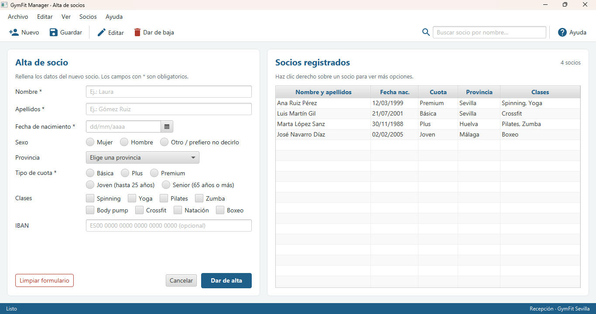
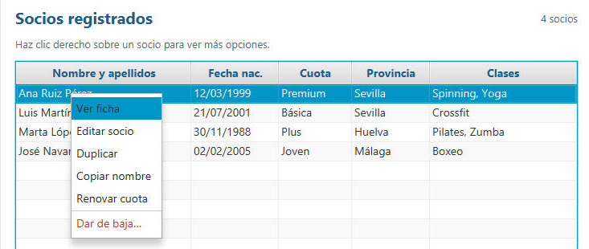
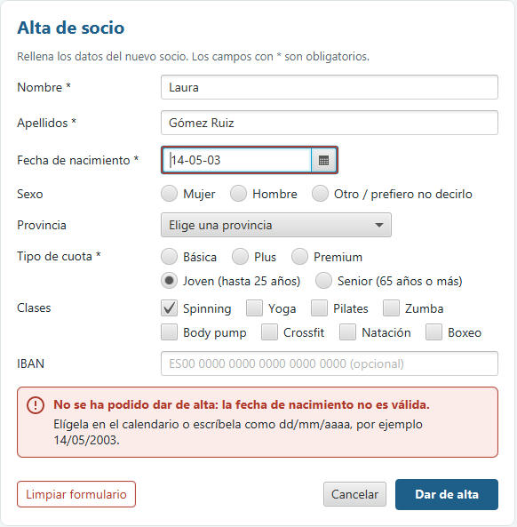
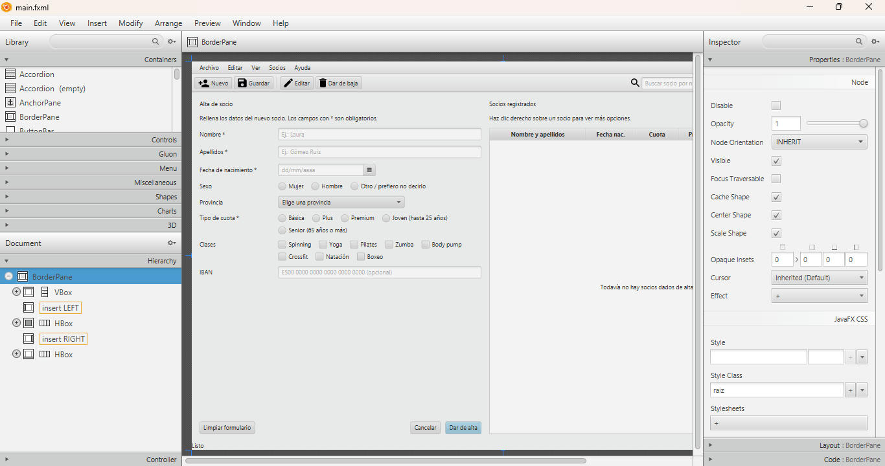

# GymFit Manager · Rediseño de la pantalla de alta de socios

Tarea 6-7 de Desarrollo de Interfaces (2.º DAM, MEDAC).
Alumno: Sergio Mitchell Bocero (sergiomitbo)

## Qué es

Rediseño en JavaFX de la pantalla de alta de socios de GymFit Manager, aplicando las pautas de usabilidad de los temas 6 y 7.
La vista está hecha en FXML (`main.fxml`) y se puede abrir y editar con Scene Builder.

Cambios principales respecto a la pantalla original:

- Barra de menús en orden estándar (Archivo, Editar, Ver, Socios, Ayuda) con atajos de teclado.
- Barra de herramientas con iconos y texto, y tooltips con el atajo.
- Formulario con el control adecuado para cada dato: selector de fecha, botones de opción, desplegable, casillas y campos con ejemplo.
- Botón principal «Dar de alta» destacado y «Limpiar formulario» separado y con confirmación.
- Tabla de socios con título, encabezados y menú contextual de 6 opciones sin submenús.
- Mensajes de error que explican qué ha pasado y cómo solucionarlo.
- Paleta de 4 colores y una sola tipografía.

## Cómo ejecutar

Hace falta JDK 21 y Maven (o abrir el proyecto con IntelliJ IDEA, que ya trae Maven).

```
mvn clean javafx:run
```

## Estructura

```
src/main/java/es/medac/sergiomitbo/gymfit/
├── App.java              -> arranca la aplicación (1280 x 800)
├── MainController.java   -> lógica de la pantalla
└── Socio.java            -> datos de un socio
src/main/resources/es/medac/sergiomitbo/gymfit/
├── main.fxml             -> la vista (Scene Builder)
└── estilos.css           -> colores y tipografía
```

## Capturas









## Créditos

Iconos de la barra de herramientas: Material Icons de Google (licencia Apache 2.0), dibujados con SVGPath.
